  

  
  
  
  

I'm a DevSecOps engineer at **Datadog** with 5+ years in security: SOC detection at Deloitte (via NSEIT), cloud security at BrowserStack, and shift-left security today. Most of what I build now is AI agents whose guardrails are enforced in code and covered by tests, not written into a prompt. In my spare time I hunt bugs on HackerOne.

### What I work on

| | |
|---|---|
| **AI & LLM security** | Prompt injection defense, agent guardrails, MCP security, RAG hardening, AI red-teaming (OWASP LLM Top 10, MITRE ATLAS) |
| **Cloud & DevSecOps** | AWS security, CI/CD security gates, infrastructure as code, compliance automation (SOC 2, ISO 27001, HIPAA) |
| **Detection & response** | SIEM engineering, ML risk scoring, MITRE ATT&CK mapping, SOAR playbooks |
| **Offensive security** | Bug bounty, source-code security audits, pentest automation |

### Featured projects

| Project | What it does | Stack |
|---|---|---|
| [**attest**](https://github.com/svemula17/attest) | Continuous compliance for SOC 2, ISO 27001 and HIPAA from one control catalog. Evidence is SHA-256 hash-chained, the AI agent only drafts answers it can cite, and a named human signs anything that leaves. | Python · Postgres · OIDC · MCP |
| [**smart-siem-risk-engine**](https://github.com/svemula17/smart-siem-risk-engine) | SIEM + SOAR built from scratch: ingests raw events, maps them to MITRE ATT&CK, scores risk with an Isolation Forest model, triggers automated response and streams to a live analyst dashboard. | Python · FastAPI · scikit-learn |
| [**vigil**](https://github.com/svemula17/vigil) | Real-time CCTV threat detection with YOLOv8, WebSocket streaming to a React dashboard, and SMS alerts. It never auto-dials emergency services; a human decides. | Python · YOLOv8 · FastAPI · React |
| [**security-audit-rivet**](https://github.com/svemula17/security-audit-rivet) | Security audit of Ironclad's Rivet, an Electron app for building AI agents. 15 findings, 3 critical: code injection, ReDoS and XSS. | TypeScript · AppSec |
| [**resume-to-portfolio**](https://github.com/svemula17/resume-to-portfolio) | Turns a resume into a static portfolio site entirely in the browser, with no backend, no upload and no LLM. [Live demo](https://svemula17.github.io/resume-to-portfolio/) | TypeScript |

### Recently

- **Finalist, Dell × NVIDIA Local AI Hackathon** (NYC, Aug 2026). I built the agent pipeline and security layer for SENTRY, an on-device door-camera agent with a learned alerting policy. Faceprints never leave the device.
- **Writing:** *MCP Security: The Attack Surface You Didn't Know You Had*, and a breakdown of the Hugging Face AI agent supply-chain breach. Both are [on LinkedIn](https://www.linkedin.com/in/saikumar-cybersecurity/recent-activity/all/).
- **Building:** a prompt injection training range where you try to break a guarded AI agent across eight levels (Serverpod + Flutter).

### Toolbox

  

**Security tooling:** LangGraph · Splunk · Nmap · Metasploit · SQLMap · scikit-learn · YOLOv8 · MCP

**Credentials:** CompTIA Security+ · M.S. Cybersecurity, Yeshiva University
